# Real Chat

A real-time chat application built with Flutter and Firebase.

I built this project to practice Flutter app development and learn how authentication, user management, and real-time communication work with Firebase.

The application includes user authentication, a people discovery page, chat functionality, and a profile section.

## Screenshots

### Authentication

| Login | Sign Up |
|:---:|:---:|
| 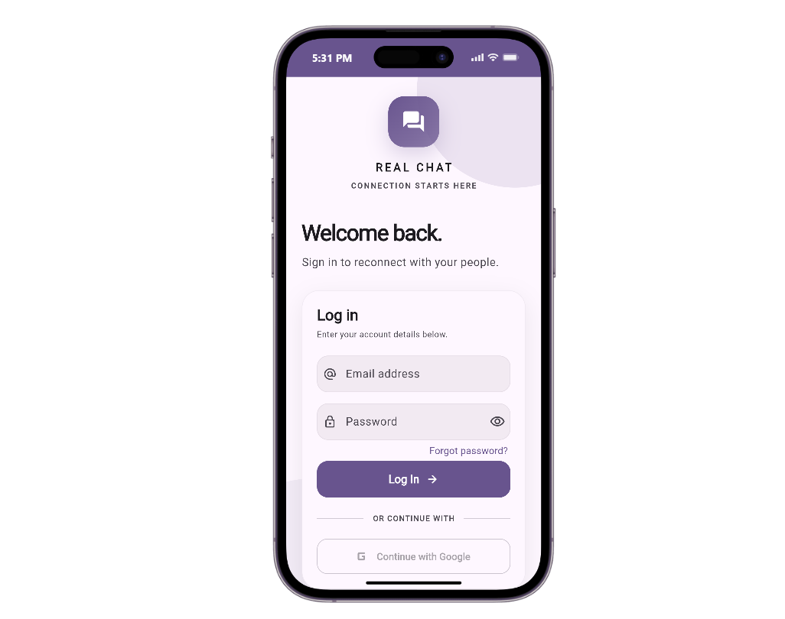 | 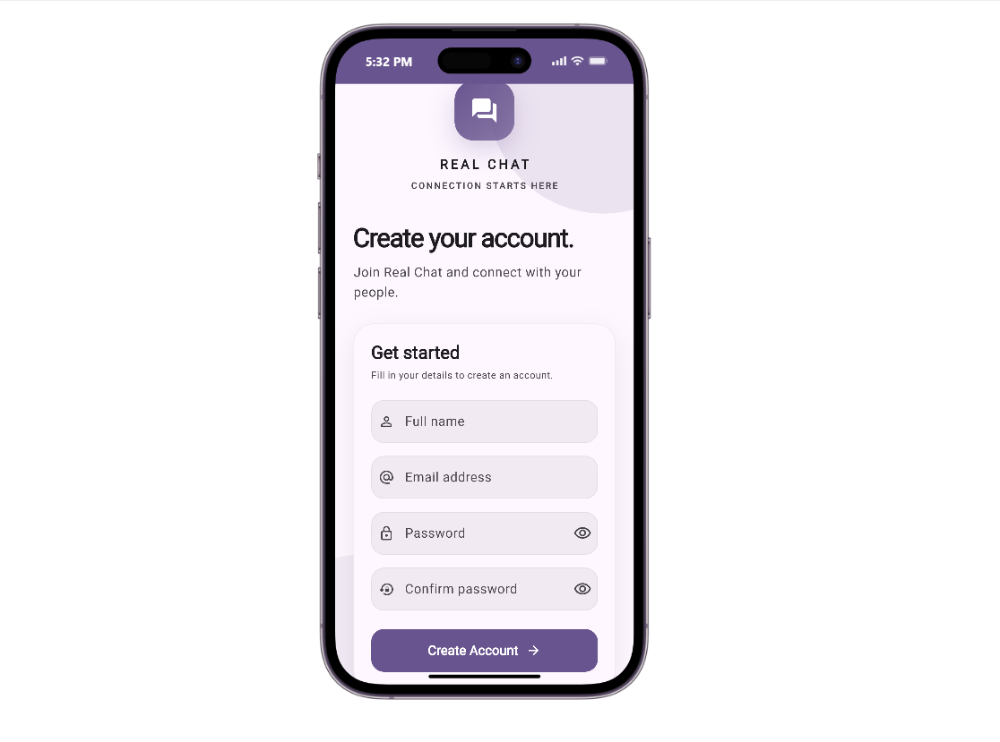 |

### Home

| Home | Home - Additional View |
|:---:|:---:|
| 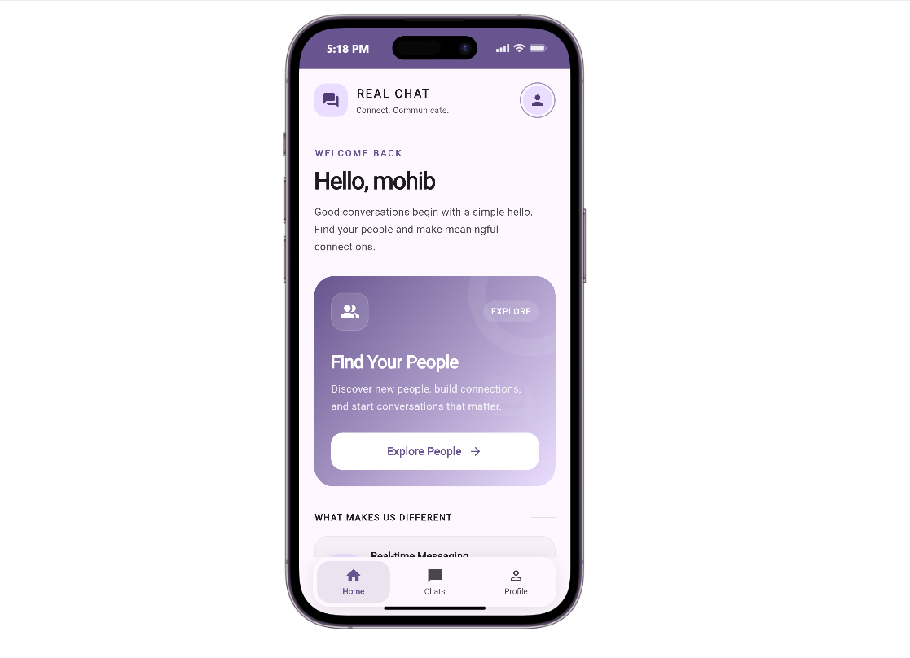 | 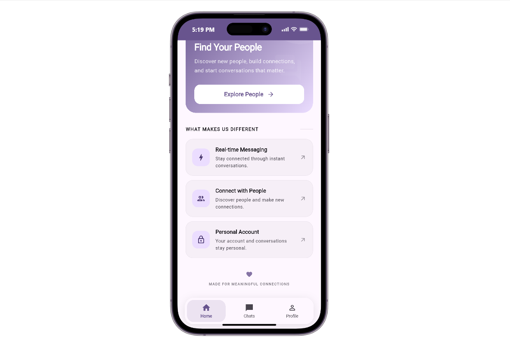 |

### Find People

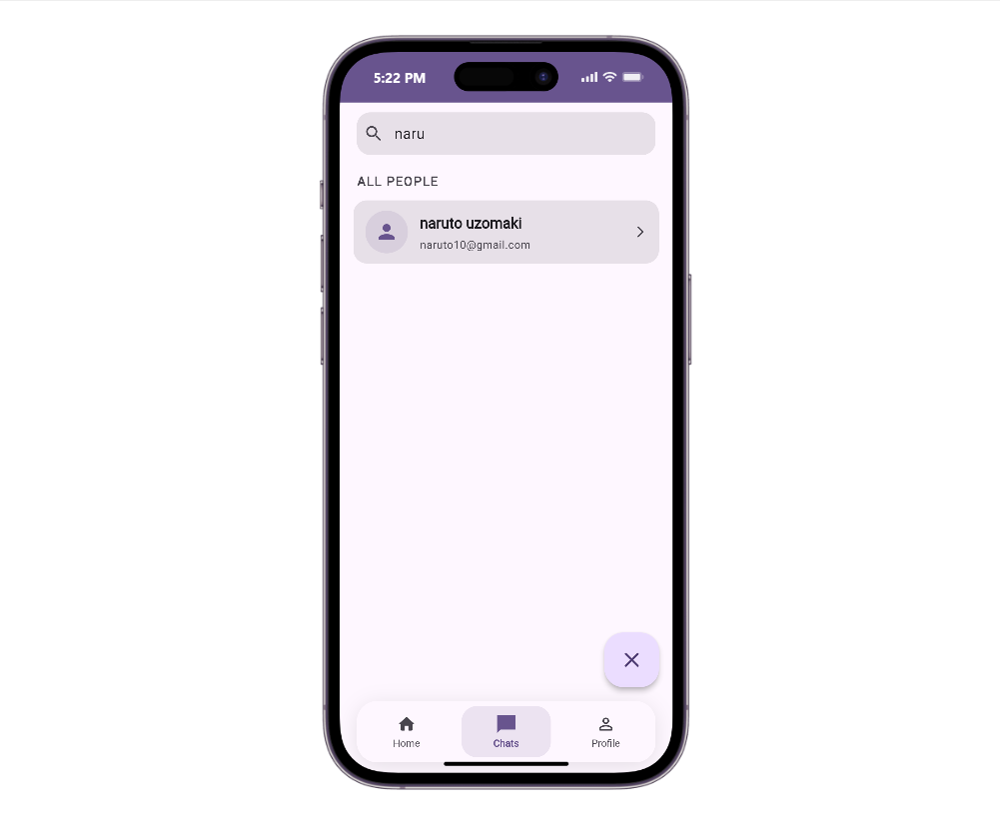

### Chats

| Chats | Conversation |
|:---:|:---:|
| 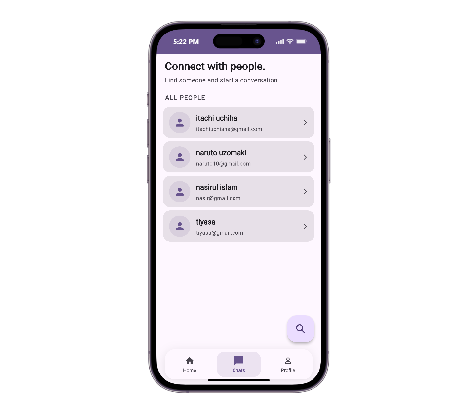 | 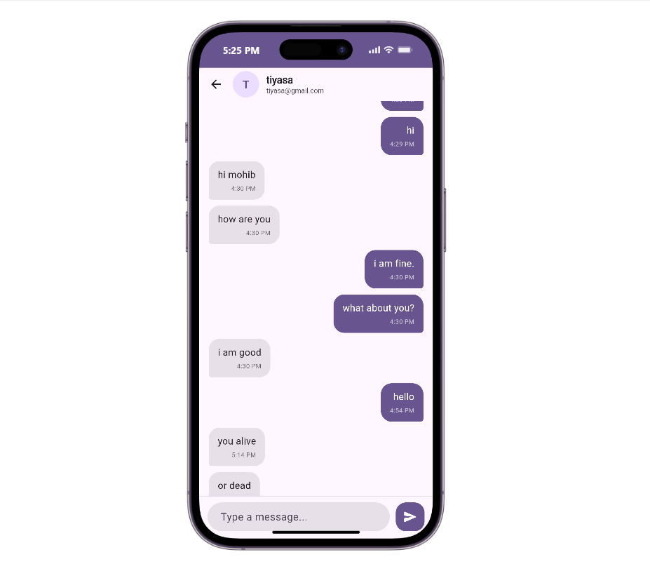 |

### Profile

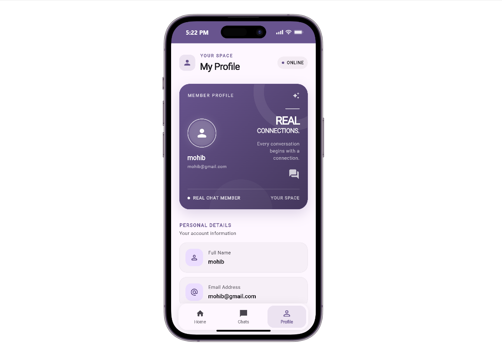

### About

| About | About - Additional View |
|:---:|:---:|
| 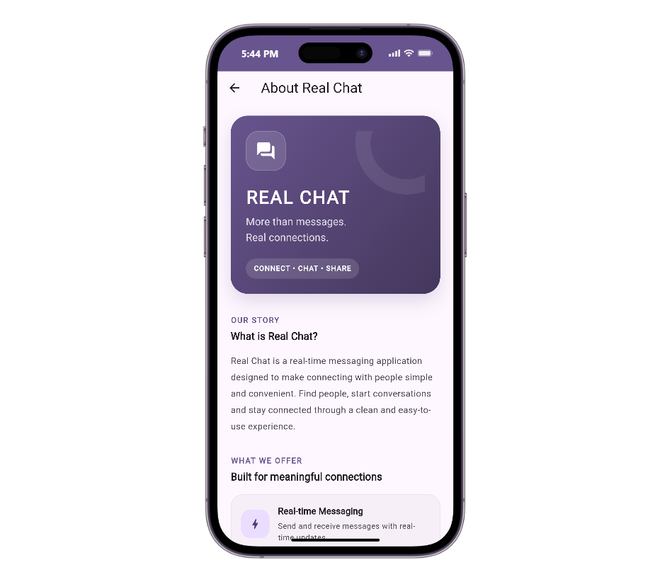 | 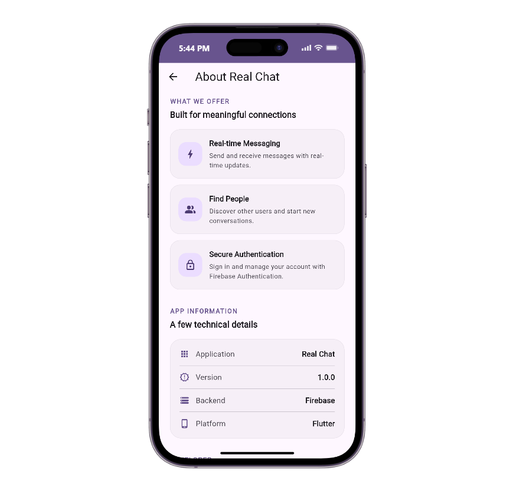 |

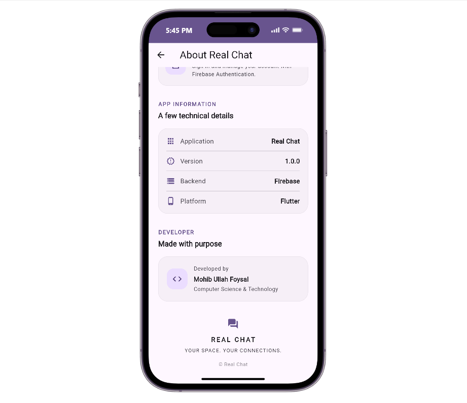

### Logout

| Logout | Logout Confirmation |
|:---:|:---:|
| 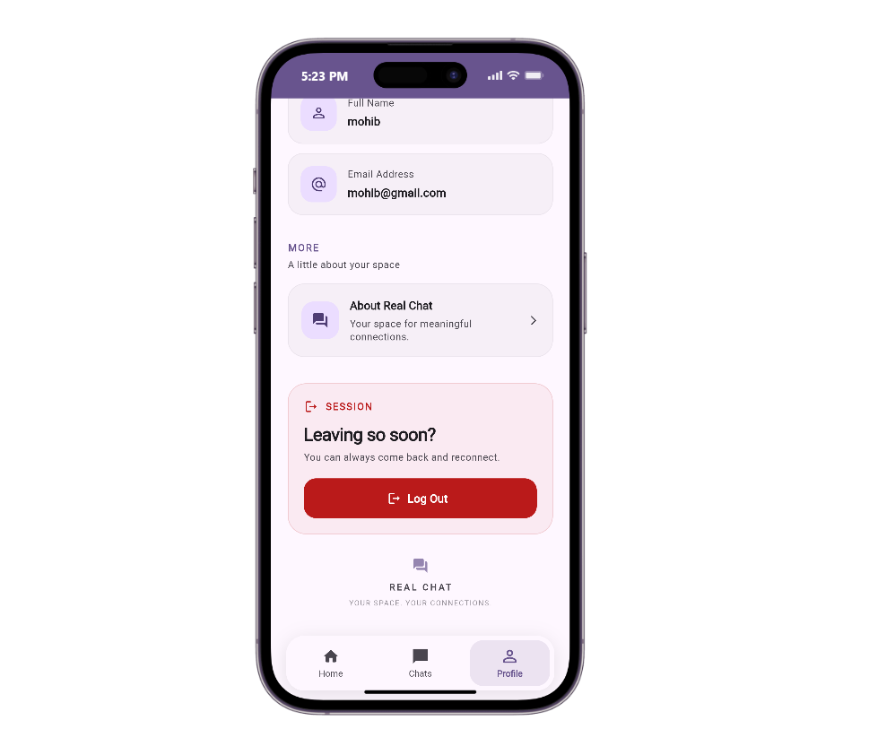 | 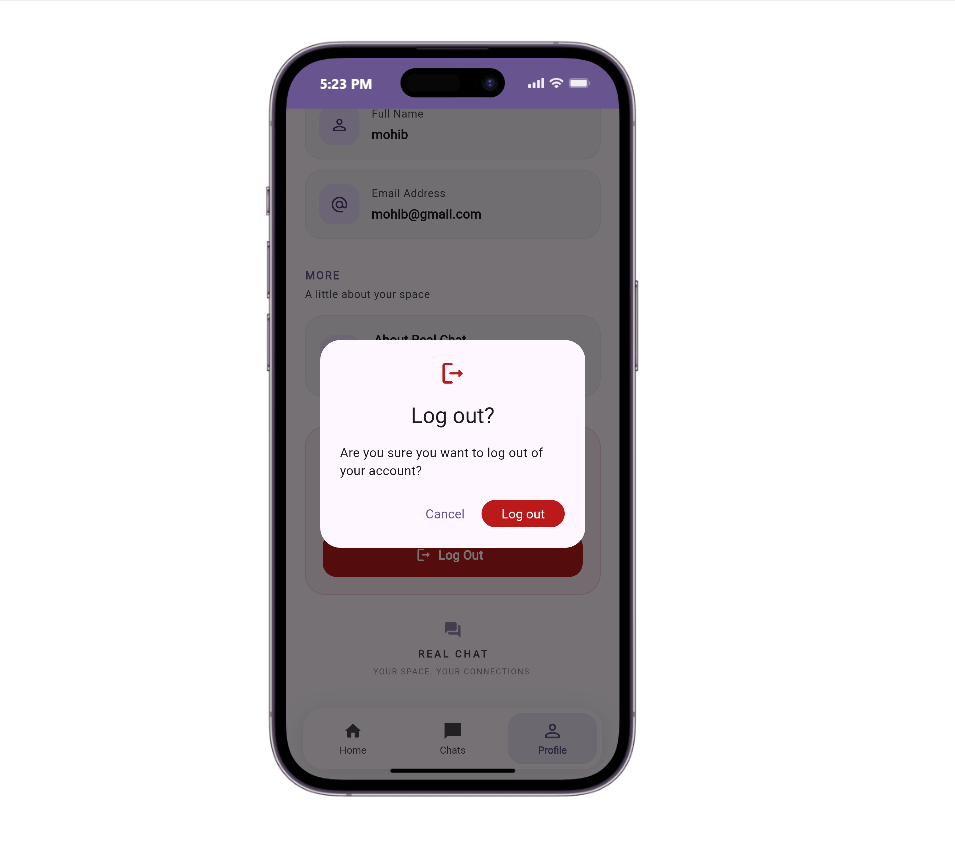 |
## Features

- User registration and login with email and password.
- Firebase Authentication for user authentication.
- User information stored in Cloud Firestore.
- Find and search for other registered users.
- Open a chat with another user.
- One-to-one chat functionality.
- Profile page with user information.
- Logout with confirmation dialog.
- About page with application information.

## Tech Stack

| Technology | Purpose |
|---|---|
| Flutter | UI development |
| Dart | Programming language |
| Firebase Authentication | User authentication |
| Cloud Firestore | Database and real-time data |
| Material Design | UI components |

## Project Structure

The project follows a feature-based folder structure to keep the code organized and easier to maintain.

```text
lib/
├── features/
│   ├── auth/
│   │   ├── data/
│   │   └── presentation/
│   │
│   ├── chat/
│   │   ├── data/
│   │   └── presentation/
│   │
│   ├── home/
│   │   └── presentation/
│   │
│   ├── profile/
│   │   └── presentation/
│   │
│   └── navigation/
│       └── presentation/
│
├── firebase_options.dart
└── main.dart

assets/
└── screenshots/
```

## Getting Started

Follow these steps to run the project locally.

### Prerequisites

Make sure you have installed:

- Flutter SDK
- Dart SDK
- Android Studio or VS Code
- Firebase account

### Installation

**1. Clone the repository**

```bash
git clone https://github.com/MUfoysal/real-chat.git
```

**2. Navigate to the project directory**

```bash
cd real-chat
```

**3. Install dependencies**

```bash
flutter pub get
```

### Firebase Setup

This project uses Firebase Authentication and Cloud Firestore.

To configure Firebase:

1. Create a project in the [Firebase Console](https://console.firebase.google.com/).
2. Add your Android application using the project's Android package name.
3. Enable Email/Password authentication.
4. Create a Cloud Firestore database.
5. Configure Firestore security rules.
6. Install and configure FlutterFire CLI.
7. Run the following command:

```bash
flutterfire configure
```

This generates the Firebase configuration for your application.

Make sure your Firebase configuration files are correctly placed before running the app.

### Run the Application

```bash
flutter run
```

## What I Learned

While building this project, I worked with:

- Flutter UI development and navigation.
- Firebase Authentication.
- Cloud Firestore integration.
- Managing user data.
- Organizing code using a feature-based structure.
- Building a chat application workflow.

## Developer

**Mohib Ullah Foysal**

Computer Science & Technology Student

- GitHub: [MUfoysal](https://github.com/MUfoysal)

---

This project is part of my journey to improve my Flutter development and software engineering skills.

